<!--
  Every link to the portfolio carries utm_content=<spot>, so your site analytics
  can show which part of this README people click from.
  Images are generated: scripts/halftone.py (portrait), scripts/contributions.py (the
  contributions card, redrawn daily by the workflow) and scripts/readme_assets.py (the rest).
-->

<!-- Wave banners, rolling (scripts/readme_assets.py). -->

  <a href="https://themuhammadismail.com/?utm_source=github&amp;utm_medium=profile&amp;utm_content=portrait">
    <picture>
      <source media="(prefers-color-scheme: dark)" srcset="assets/portrait-halftone.svg">
      
    </picture>
  </a>

  <a href="https://themuhammadismail.com/?utm_source=github&amp;utm_medium=profile&amp;utm_content=name">
    <picture>
      <source media="(prefers-color-scheme: dark)" srcset="assets/name-dark.svg">
      
    </picture>
  </a>

  
  
  
  
  

  

<!-- Redrawn daily by .github/workflows/update-profile.yml (scripts/contributions.py). -->

  <a href="https://themuhammadismail.com/?utm_source=github&amp;utm_medium=profile&amp;utm_content=contributions#github-activity-heading">
    <picture>
      <source media="(prefers-color-scheme: dark)" srcset="assets/contributions-3d-dark.svg">
      
    </picture>
  </a>

<!-- The last 12 months, this week and the languages, from GitHub; redrawn daily (scripts/github_cards.py). -->

  <picture>
    <source media="(prefers-color-scheme: dark)" srcset="assets/activity-dark.svg">
    
  </picture>

<h2 align="center">
  <picture>
    <source media="(prefers-color-scheme: dark)" srcset="assets/header-projects-dark.svg">
    
  </picture>
</h2>

<!-- The repos pinned on this profile, one card each; this block is rewritten daily by
     scripts/github_cards.py (pin or unpin on GitHub to change it). -->
<!-- pinned:start -->

  <a href="https://github.com/ixismail/redis">
    <picture>
      <source media="(prefers-color-scheme: dark)" srcset="assets/repo-1-dark.svg">
      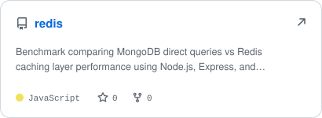
    </picture>
  </a>
  <a href="https://github.com/ixismail/hushdoom">
    <picture>
      <source media="(prefers-color-scheme: dark)" srcset="assets/repo-2-dark.svg">
      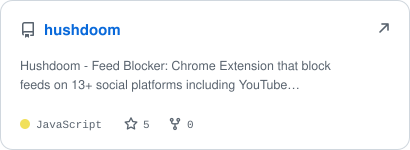
    </picture>
  </a>

  <a href="https://github.com/ixismail/nukeport">
    <picture>
      <source media="(prefers-color-scheme: dark)" srcset="assets/repo-3-dark.svg">
      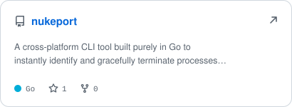
    </picture>
  </a>

<!-- pinned:end -->

<h2 align="center">
  <picture>
    <source media="(prefers-color-scheme: dark)" srcset="assets/header-toolbox-dark.svg">
    
  </picture>
</h2>

<!-- 3 rows: languages · frontend + backend · data, infra + tools -->

  <picture>
    <source media="(prefers-color-scheme: light)" srcset="https://skillicons.dev/icons?i=go,ts,js,php,cpp,bash,html,css,react,nextjs,tailwind,nodejs,nestjs,express,deno,supabase,postgres,mysql,mongodb,redis,docker,githubactions,cloudflare,vercel,linux,git,github&amp;perline=9&amp;theme=light">
    
  </picture>

<!-- From my bucket list and my homepage (scripts/extras.py). -->

  <a href="https://themuhammadismail.com/bucket-list?utm_source=github&amp;utm_medium=profile&amp;utm_content=achievements">
    <picture>
      <source media="(prefers-color-scheme: dark)" srcset="assets/achievements-dark.svg">
      
    </picture>
  </a>

  <a href="https://themuhammadismail.com/contact?utm_source=github&amp;utm_medium=profile&amp;utm_content=ask-me">
    <picture>
      <source media="(prefers-color-scheme: dark)" srcset="assets/notes-dark.svg">
      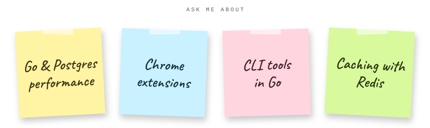
    </picture>
  </a>

  <picture>
    <source media="(prefers-color-scheme: dark)" srcset="assets/clock-dark.svg">
    
  </picture>
  <a href="https://themuhammadismail.com/?utm_source=github&amp;utm_medium=profile&amp;utm_content=hero">
    <picture>
      <source media="(prefers-color-scheme: dark)" srcset="assets/hero-dark.svg">
      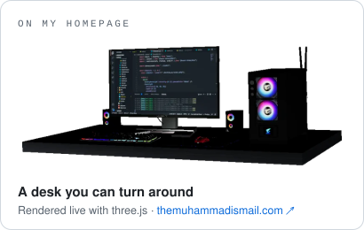
    </picture>
  </a>

 

<!-- The portfolio's closing call to action, drawn as one image (scripts/readme_assets.py). -->

  <a href="https://themuhammadismail.com/contact?utm_source=github&amp;utm_medium=profile&amp;utm_content=cta">
    <picture>
      <source media="(prefers-color-scheme: dark)" srcset="assets/cta-dark.svg">
      
    </picture>
  </a>

 

<!-- The sign-off writes itself in (Pacifico outlines: scripts/lettering.py). -->

  <picture>
    <source media="(prefers-color-scheme: dark)" srcset="assets/thanks-dark.svg">
    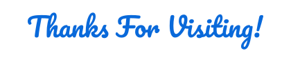
  </picture>

  <a href="#readme-top">
    <picture>
      <source media="(prefers-color-scheme: dark)" srcset="assets/top-dark.svg">
      
    </picture>
  </a>

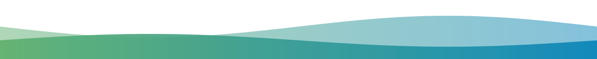
